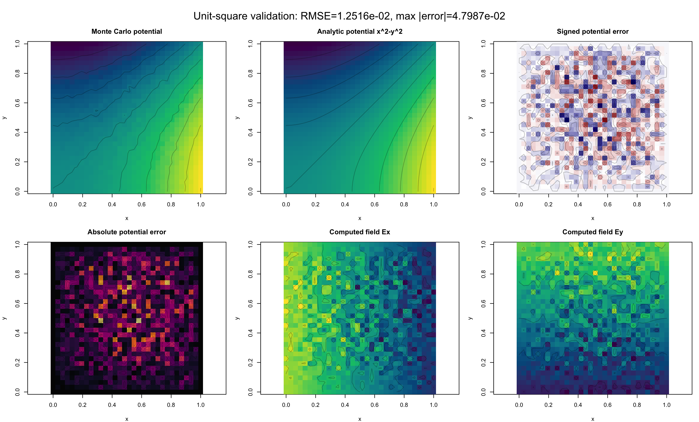

# GPU-accelerated electrostatic field simulation

[](https://github.com/dcw06/ElectronicSimulator/actions/workflows/ci.yml)

Monte Carlo random-walk solvers for the 2D Laplace equation with Dirichlet boundaries. CPU, CUDA, and MUSA implementations estimate potential; finite differences recover the electric field. Analytic solutions provide a check on numerical error.

**[Main solver](mc_field_solver/README.md) · [CUDA/MUSA example in Chinese](docs/README.zh-CN.md) · [CPU validation](https://github.com/dcw06/ElectronicSimulator/actions)**



The figure is a committed example from the quadratic-boundary implementation, not a performance benchmark.

## Two implementations

| Directory | Purpose | Analytic validation |
|---|---|---|
| `mc_field_solver/` | CMake application, CPU/CUDA backends, MUSA build script, and local web interface | `u(x,y)=x`, so `E=(-1,0)` |
| `摩尔线程/` | Compact shared-source CUDA/MUSA example with a CPU reference | `u(x,y)=x²-y²`, so `E=(-2x,2y)` |

One GPU block handles a query grid point, with independent random walks and an average over boundary hits. Sampling error falls approximately as `1/sqrt(N)`; increasing samples does not eliminate discretization or finite-walk-limit error.

## Build and validate without a GPU

Requires a C++17 compiler and CMake 3.24+.

```bash
git clone https://github.com/dcw06/ElectronicSimulator.git
cd ElectronicSimulator
cmake -S mc_field_solver -B build -DMC_ENABLE_CUDA=OFF -DCMAKE_BUILD_TYPE=Release
cmake --build build --parallel 2
ctest --test-dir build --output-on-failure
./build/mc_field_solver --nx 64 --ny 64 --walks 4096 --backend cpu --output output
```

To build the second implementation, change into its directory first:

```bash
cd 摩尔线程
make cpu
./mc_laplace_cpu 32 32 4096
```

See the per-directory READMEs for CUDA/MUSA toolchain requirements and visualization. Native executables are rebuilt locally rather than committed.

## Evidence and limits

- CI checks the main solver's existing analytic-boundary CPU regression and builds the second CPU reference.
- GPU speedup has not been established by a published hardware-matched benchmark; no acceleration factor is claimed.
- Report hardware, compiler flags, grid, walk count, step cap, runtime, and numerical error together when comparing backends.
- Maintained by Chongwei (Alan) Dai; CPU/GPU validation and implementation details are separate from upstream SDK/toolchain work.
